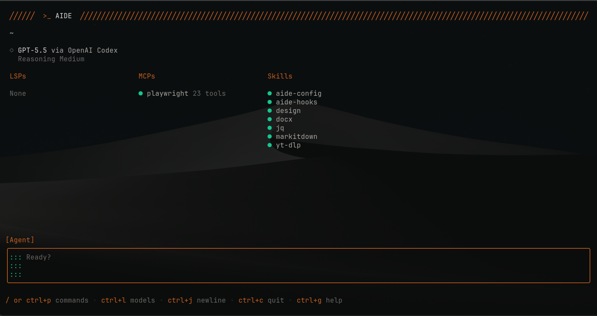
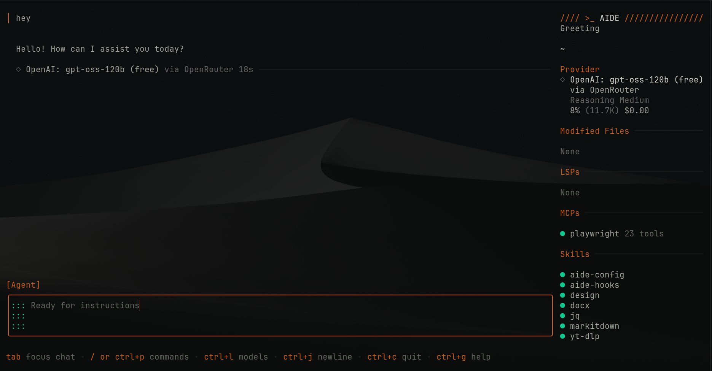

# aide

<p align="center">
  
</p>

**aide** is a terminal-first AI coding assistant that works with any LLM.
It runs in your terminal, understands your project, and can read, write, and
execute code on your behalf.

<p align="center">
  
</p>

## Features

- **Two agent modes** — **Build** can edit and run commands. **Plan** is
  read-only for research and review. Switch between them with `shift+tab`.
- **Any provider** — Anthropic, OpenAI, Gemini, Bedrock, Copilot, Azure,
  OpenRouter, Vercel, Ollama, LM Studio, llama.cpp, and any compatible API.
- **Session-based** — Each session keeps its own conversation history and
  context. Switch between multiple work streams without losing state.
- **Code-aware** — Connects to LSP servers for diagnostics, references, and
  code intelligence. Adds tools via MCP.
- **Project context** — Automatically reads `AGENTS.md`, `CLAUDE.md`,
  `GEMINI.md`, and your project's `.cursorrules` or Copilot instructions.
- **Extensible** — Agent Skills (SKILL.md), MCP servers, and hooks for
  programmable safety guards.
- **Plays nice** — Permission controls, allow-lists, and a `--yolo` mode
  for fully automated operation. Works headlessly with `aide run`.

## Quick Start

```bash
go install github.com/liamb/aide@latest

# Set your API key
export ANTHROPIC_API_KEY=sk-ant-...

# Launch
aide
```

Or run a one-shot prompt:

```bash
aide run "Explain the architecture of this project"
```

## Common Workflows

```bash
# Run a prompt from stdin
curl https://example.com | aide run "Summarize this"

# Continue the most recent session
aide run --continue "Follow up on your last response"

# Redirect output to a file
aide run "Write a README for this project" > README.md

# Start a server for remote access
aide server

# Connect to a remote server
aide --host /path/to/socket
```

## Configuration

Place `aide.json` or `.aide.json` in your project root, or globally at
`~/.config/aide/aide.json`.

```json
{
  "providers": {
    "anthropic": {
      "api_key": "$ANTHROPIC_API_KEY"
    }
  }
}
```

## Keybindings

| Key | Action |
|-----|--------|
| `shift+tab` | Switch agent mode (Plan/Build) |
| `ctrl+p` | Command palette |
| `ctrl+l` | Switch model |
| `ctrl+s` | Switch session |
| `ctrl+n` | New session |
| `ctrl+g` | Help |

## Acknowledgments

Built on the [Charm](https://charm.land) ecosystem — Bubble Tea, Lip Gloss,
Glamour, Ultraviolet, and more.